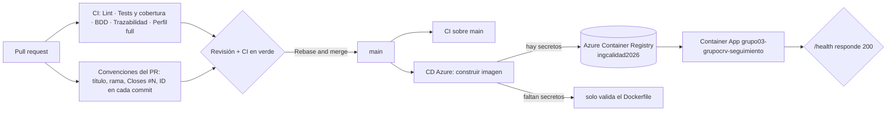

# Integración y entrega continua (CI/CD)

Todo lo que se verifica o se publica sin intervención humana vive en `.github/workflows/`. Este
documento explica qué hace cada workflow, cómo se protege la rama `main` y cómo se configura el
despliegue continuo en Azure.



## Qué se ejecuta y cuándo

| Workflow | Cuándo | Qué comprueba |
|---|---|---|
| `ci.yml` · **Lint** | PR y `main` | Plantillas generadas, `go vet`, formato, `golangci-lint` y `actionlint` sobre los propios workflows |
| `ci.yml` · **Tests y cobertura** | PR y `main` | Todos los tests con una base Postgres real y los umbrales de cobertura: **85 % en el dominio** y **70 % total** (`scripts/coverage.sh`). Publica el reporte HTML como artefacto |
| `ci.yml` · **BDD** | PR y `main` | Los escenarios Gherkin con godog, también contra Postgres |
| `ci.yml` · **Trazabilidad** | PR y `main` | Avisa si una spec de historia no tiene su `.feature` |
| `ci.yml` · **Perfil full** | PR y `main` | Levanta el `docker compose` completo sobre un volumen vacío y revisa la base (el camino de quien evalúa) |
| `pr-title.yml` · **Convenciones del PR** | PR | Título en Conventional Commits con ID, rama con el formato `tipo/ID-slug`, `Closes #N` en el cuerpo y **el ID en cada commit** del PR (T-014) |
| `cd-azure.yml` · **CD (Azure)** | push a `main` (menos cambios solo de documentación) y a mano | Construye la imagen Docker; si están los secretos y la variable `CD_ACTIVO` vale `true`, la publica en el registro y despliega esa versión en la Container App |
| `verificar-azure.yml` · **Verificar Azure (solo lectura)** | a mano (desde `main`) | Con las credenciales reales, comprueba secretos, nombre de la app, base de datos, acceso a Azure y al registro. No crea, cambia ni borra nada y no gasta créditos |

## Protección de `main`

Nadie sube a `main` directamente. Las reglas de la rama, que se pueden ver en *Settings → Branches*:

- Hay que pasar los chequeos **Lint**, **Tests y cobertura**, **BDD** y **Titulo y rama**, y la rama tiene que estar al día con `main`.
- Hace falta **1 aprobación** de alguien que no sea el autor, y de un dueño del código cuando el cambio toca su área (`.github/CODEOWNERS`: el dominio y la configuración, de Tomás y Vergara; las specs y los escenarios, de los tres).
- Un cambio nuevo en el PR **descarta** las aprobaciones anteriores.
- Se mergea siempre con *Rebase and merge*, para que la historia conserve los commits RED y GREEN de cada ciclo TDD.

## CD: desplegar en Azure

La cuenta de Azure es **compartida por todos los grupos y tiene créditos limitados**. Por eso el workflow
`cd-azure.yml` está pensado para gastar lo mínimo y para tocar solo lo del grupo 03.

En cada merge a `main` que cambie algo de lo que entra en la imagen (los cambios solo de `*.md`,
`docs/`, `specs/` y `features/` no disparan nada):

1. **Configuración:** revisa si existen los secretos de abajo. Si falta alguno, avisa con una anotación y
   sigue sin publicar ni desplegar (el repositorio no se pone en rojo antes de tener las credenciales).
2. **Imagen:** construye el `Dockerfile` en Ubuntu, la publica como
   `ingcalidad2026.azurecr.io/grupo03-grupocrv:sha-<commit>` y `:latest`, y borra las etiquetas
   `sha-<commit>` más viejas de **esa** imagen (se conservan las 10 últimas).
3. **Despliegue:** actualiza la Container App `grupo03-grupocrv-seguimiento` con esa imagen (0,25 vCPU,
   0,5 GiB, mínimo de réplicas en 0) y le pasa la cadena de conexión de la base como secreto de la app.
   Si la app todavía no existe, la crea.
4. **Comprobación:** pide `/health` hasta 12 veces, 10 segundos entre intentos (la app escala a cero: la
   primera visita la despierta, y la base de Neon también). Si no responde 200, el workflow falla y muestra
   los últimos logs de la app. El resumen de la ejecución deja la URL.

### Cómo configurarlo (una sola vez)

**1. Crear el Environment `azure` y limitarlo a `main`.** Los secretos de un Environment solo los reciben los
jobs que corren desde las ramas permitidas. Con *Secrets* comunes del repositorio, cualquiera con permiso de
escritura podría escribir un workflow en su propia rama y leerlos; con el Environment limitado a `main` no,
porque `main` está protegida. Lo hace quien tiene permisos de administrador:

```bash
bash scripts/crear-entorno-azure.sh
```

**2. Cargar las variables y los secretos.** Lo hace quien tiene los datos que entregó la cátedra, en su propia
terminal; los valores no pasan por ningún chat ni archivo (los secretos se piden sin mostrarlos y se mandan directo
a GitHub):

```bash
bash scripts/configurar-azure.sh
```

El script pide los nombres con los que los entregó la cátedra y deja el despliegue automático **apagado**
(`CD_ACTIVO=false`, que además es el valor si la variable no existe) hasta que se verifique. Si se prefiere a mano, es lo mismo que *Settings → Environments →
azure* o `gh secret set <NOMBRE> --env azure` y `gh variable set <NOMBRE> --env azure --body <valor>`.

| Secreto | Valor |
|---|---|
| `AZURE_CREDENTIALS` | El JSON del *service principal* con `clientId`, `clientSecret`, `subscriptionId` y `tenantId` (el script lo arma con los cuatro datos) |
| `ACR_PASSWORD` | Opcional. La clave del registro que entrega la cátedra: con ella el login y la limpieza del registro usan usuario y clave y no dependen de los roles del *service principal* |
| `DATABASE_URL` | La cadena de conexión de la base (ver "La base de datos"), sin `channel_binding` |

Variables (si no existen se usan los datos del grupo 03; entre paréntesis, el nombre con el que las entregó la cátedra):

| Variable | Valor por defecto | Para qué |
|---|---|---|
| `ACR_NAME` | `ingcalidad2026` | Registro de la cátedra (sin `.azurecr.io`). Es compartido: el workflow nunca lo crea ni lo borra |
| `ACR_URL` | `<ACR_NAME>.azurecr.io` | Servidor del registro (`acrname_url`) |
| `IMAGE_NAME` | `grupo03-grupocrv` | Imagen del grupo dentro del registro. Tiene que empezar con `grupo03-` |
| `RESOURCE_GROUP` (`AZURE_RESOURCE_GROUP`) | `frsrutn` | Grupo de recursos |
| `CONTAINER_APP_NAME` | `grupo03-grupocrv-seguimiento` | Container App. Tiene que empezar con `grupo03-` y tener **32 caracteres o menos** (límite de Azure) |
| `CONTAINER_APPS_ENV` (`AZURE_CONTAINERAPPS_ENVIRONMENT`) | — | Entorno de Container Apps. Solo hace falta si la app todavía no existe |
| `CARGAR_DATOS_EJEMPLO` | `true` | Carga el proyecto de ejemplo al arrancar, para la demo (es idempotente) |
| `MIN_REPLICAS` | `0` | Réplicas mínimas. `0`: sin visitas no corre ni cobra. `1` solo el día de la presentación, para evitar el arranque en frío |
| `CD_ACTIVO` | `false` | Interruptor general de costos: **solo con `true`** se publica y se despliega. Sin la variable, o con cualquier otro valor, el workflow solo valida el Dockerfile aunque estén todos los secretos |

El nombre que la cátedra asignó a la Container App (`grupo03-grupocrv-seguimientoymedicion`) tiene 37 caracteres y
Azure acepta hasta 32, así que se usa `grupo03-grupocrv-seguimiento` (28). El workflow rechaza un nombre inválido
antes de llamar a Azure.

El *service principal* necesita permisos de escritura sobre el grupo de recursos (por ejemplo *Contributor*) para
actualizar la Container App. Para publicar la imagen alcanza con `ACR_PASSWORD` o con el rol `AcrPush` sobre el
registro. Para **crear** la app desde el workflow hace falta `ACR_PASSWORD` (o el usuario administrador del registro
habilitado), o que la app ya exista con su acceso al registro configurado.

**3. Verificar sin gastar nada.** *Actions → Verificar Azure (solo lectura) → Run workflow* (corre desde `main`).
Con las credenciales reales comprueba que estén los secretos, que el nombre de la app sea válido, que la base
acepte la conexión, que el *service principal* vea el grupo de recursos, el entorno y la app (y con qué roles
cuenta) y que la clave del registro funcione. El resumen de la ejecución deja una tabla con cada comprobación. No
crea, cambia ni borra nada.

**4. Primer despliegue.** Con la verificación en verde: `gh variable set CD_ACTIVO --env azure --body true` y
*Actions → CD (Azure) → Run workflow*. Desde ahí, cada merge a `main` que cambie la imagen despliega solo.

### La base de datos

La aplicación necesita PostgreSQL (aplica sus migraciones al arrancar y `/health` consulta la base). Un
contenedor Postgres dentro de Azure consume demasiado de los créditos, así que el despliegue usa una base
**externa y gratuita (Neon)**:

1. Crear un proyecto en Neon, en la región más cercana al despliegue (São Paulo, si está disponible).
2. Copiar la cadena de conexión **directa** (sin `-pooler` en el nombre del host): el *pooler* funciona en
   modo transacción y no está verificado con nuestro driver, que usa consultas preparadas.
3. **Borrarle `channel_binding=require`** a la cadena y dejar `sslmode=require`. Neon suele agregar ese parámetro, pero
   nuestro driver (`pgx` 5.7) no lo conoce y se lo manda al servidor como si fuera una opción propia; Postgres lo
   rechaza con `unrecognized configuration parameter "channel_binding"` y la app no arranca (se comprobó).
4. Guardarla como el secreto `DATABASE_URL` del Environment `azure`.

La conexión usa la contraseña de la base: las claves de API de Supabase (o de cualquier otro servicio) **no hacen
falta** y no deben entrar al repositorio ni a los secretos. Cada integrante sigue desarrollando con su Postgres
local (`make up`), sin tocar la base de Neon.

### Costos

- **Container App:** 0,25 vCPU y 0,5 GiB con **mínimo de réplicas en 0**: si nadie la visita, no corre y no
  cobra; la primera visita tarda unos segundos en arrancarla. Máximo de 1 réplica. Según la
  [documentación de facturación de Azure](https://learn.microsoft.com/en-us/azure/container-apps/billing), en el plan
  de consumo una réplica escalada a cero no genera cargos de recursos, y cada suscripción tiene gratis cada mes los
  primeros 180.000 vCPU-segundos, 360.000 GiB-segundos y 2 millones de peticiones. **Esa franja es de toda la
  suscripción de la cátedra, no de cada grupo**: la comparten todas las apps de todos los grupos.
- **Orden de magnitud:** una réplica de 0,25 vCPU encendida las 24 horas durante un mes son 648.000 vCPU-segundos, más
  de tres veces la franja gratuita de toda la suscripción. Con `MIN_REPLICAS=0` la app solo corre mientras alguien la
  usa (y unos minutos después de la última petición): una sesión de demo de una hora son 900 vCPU-segundos.
- **Registro:** compartido, no se crea ni se borra desde acá. Solo se conservan las últimas 10 etiquetas de la imagen
  del grupo.
- **GitHub Actions:** los cambios que no entran en la imagen (documentación, specs y escenarios) no construyen
  ni despliegan. El repositorio es público: los minutos de Actions son gratuitos.
- **Base de datos:** Neon en su plan gratuito, fuera de Azure.
- **Interruptor:** el despliegue está **apagado por defecto**. `gh variable set CD_ACTIVO --env azure --body true` lo
  enciende y `false` lo frena otra vez, sin tocar código.
- **El día de la presentación:** `gh variable set MIN_REPLICAS --env azure --body 1` y *Run workflow* dejan la app
  encendida (sin arranque en frío); al terminar, volver a `0`.
- **Neon también se duerme:** en el plan gratuito, la base se suspende a los 5 minutos sin uso y no se puede cambiar; despertarla
  tarda de unos cientos de milisegundos a unos segundos ([documentación de Neon](https://neon.com/docs/introduction/plans)).
  Por eso, **10 minutos antes de presentar** se abre `/health` de la app (que consulta la base) y se recorre una pantalla.
- **Plan B si Azure falla el día de la presentación:** la aplicación en local (`make up` y `make run`, o el `docker compose`
  completo) con los mismos datos, y las capturas de cada pantalla guardadas de antemano. Se ensaya el domingo.
- **Apagar todo después de la presentación:** `az containerapp delete --name grupo03-grupocrv-seguimiento
  --resource-group frsrutn` (no borrar nada que no empiece con `grupo03-`).

### Seguridad

- **Los secretos nunca se escriben dentro de un script del workflow:** llegan por variables de entorno y GitHub los
  oculta en el log. El JSON de Azure solo lo recibe `azure/login`.
- **Las acciones de terceros están fijadas por el hash exacto de su versión** (`azure/login`, `docker/*`). Si alguien
  moviera la etiqueta de una versión, el workflow seguiría usando el código que se revisó.
- **Permisos mínimos:** el token del workflow solo puede leer el repositorio.
- **Cuenta compartida:** el workflow se niega a desplegar o a borrar etiquetas de algo que no empiece con `grupo03-`, y
  nunca borra el registro.
- **La app no tiene login y el repositorio es público:** quien conozca la URL de la Container App puede cargar y
  cambiar datos en la base de la demo. La URL se comparte solo en la presentación, y la app se apaga o se borra
  después (ver "Costos").
- **Los PR no despliegan nada:** el workflow no corre en `pull_request`, y los PR de repositorios ajenos no
  reciben los secretos.
- `actionlint` revisa todos los workflows en cada PR, con `shellcheck` sobre los scripts de cada paso.

### Qué falta comprobar con la cuenta real

El login, el push y el despliegue solo se pueden probar contra Azure con las credenciales reales. Lo que sí se verificó
sin ellas: la sintaxis de los workflows (`actionlint`), la lógica de cada script con un `az`, un `docker` y un `curl`
simulados (qué se actualiza o se crea, con qué credenciales del registro, qué etiquetas se borran y cuáles nunca, el
interruptor `CD_ACTIVO`, el límite de 32 caracteres del nombre, la espera de `/health`), la comprobación de la base contra
un Postgres real y que la cadena de conexión de Neon necesita quitarle `channel_binding`. Lo primero que se corre con
la cuenta real es *Verificar Azure (solo lectura)*, y recién después el primer despliegue.
