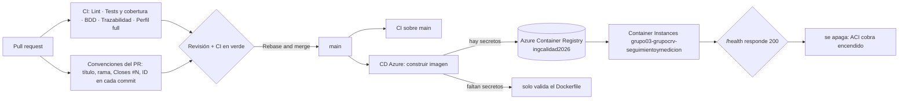

# Integración y entrega continua (CI/CD)

Todo lo que se verifica o se publica sin intervención humana vive en `.github/workflows/`. Este
documento explica qué hace cada workflow, cómo se protege la rama `main` y cómo se configura el
despliegue continuo en Azure.



## Qué se ejecuta y cuándo

| Workflow | Cuándo | Qué comprueba |
|---|---|---|
| `ci.yml` · **Lint** | PR y `main` | Plantillas generadas, `go vet`, formato, `golangci-lint` y `actionlint` sobre los propios workflows |
| `ci.yml` · **Tests y cobertura** | PR y `main` | Todos los tests con una base Postgres real y los umbrales de cobertura: **85 % en el dominio** y **70 % total** (`scripts/coverage.sh`). Publica el reporte HTML como artefacto |
| `ci.yml` · **BDD** | PR y `main` | Los escenarios Gherkin con godog, también contra Postgres |
| `ci.yml` · **Trazabilidad** | PR y `main` | Avisa si una spec de historia no tiene su `.feature` |
| `ci.yml` · **Perfil full** | PR y `main` | Levanta el `docker compose` completo sobre un volumen vacío y revisa la base (el camino de quien evalúa) |
| `pr-title.yml` · **Convenciones del PR** | PR | Título en Conventional Commits con ID, rama con el formato `tipo/ID-slug`, `Closes #N` en el cuerpo y **el ID en cada commit** del PR (T-014) |
| `cd-azure.yml` · **CD (Azure)** | push a `main` (menos cambios solo de documentación) y a mano | Construye la imagen Docker; si están los secretos y la variable `CD_ACTIVO` vale `true`, la publica en el registro, la despliega en Azure Container Instances y apaga el contenedor para no gastar créditos |
| `aci-energia.yml` · **ACI: encender o apagar** | a mano y todas las noches (03:00 de Argentina) | Enciende, apaga o informa el estado del contenedor de ACI; de noche lo apaga si quedó encendido (salvo `MANTENER_ENCENDIDO=true`) |
| `verificar-azure.yml` · **Verificar Azure (solo lectura)** | a mano (desde `main`) | Con las credenciales reales, comprueba secretos, nombre de la app, base de datos, acceso a Azure y al registro. No crea, cambia ni borra nada y no gasta créditos |

## Protección de `main`

Nadie sube a `main` directamente. Las reglas de la rama, que se pueden ver en *Settings → Branches*:

- Hay que pasar los chequeos **Lint**, **Tests y cobertura**, **BDD** y **Titulo y rama**, y la rama tiene que estar al día con `main`.
- Hace falta **1 aprobación** de alguien que no sea el autor, y de un dueño del código cuando el cambio toca su área (`.github/CODEOWNERS`: el dominio y la configuración, de Tomás y Vergara; las specs y los escenarios, de los tres).
- Un cambio nuevo en el PR **descarta** las aprobaciones anteriores.
- Se mergea siempre con *Rebase and merge*, para que la historia conserve los commits RED y GREEN de cada ciclo TDD.

## CD: desplegar en Azure

La cuenta de Azure es **compartida por todos los grupos y tiene créditos limitados**. La cátedra pidió desplegar en **Azure
Container Instances (ACI)** y no en Container Apps. Tres workflows se reparten el trabajo, pensados para gastar lo mínimo y
para tocar solo lo del grupo 03:

- `cd-azure.yml`: construye la imagen, la publica en el registro y la despliega en ACI.
- `aci-energia.yml`: enciende, apaga o informa el estado del contenedor, y lo apaga solo cada noche.
- `verificar-azure.yml`: comprueba la configuración real sin cambiar nada (solo lectura).

**Lo que hay que saber de ACI (y por qué cambia el control de costos).** Según la documentación de Microsoft, ACI cobra por segundo
**mientras el contenedor está encendido**, desde que empieza a bajar la imagen hasta que se detiene, y **no escala a cero**:
un contenedor encendido cobra aunque nadie lo visite. Detenido, deja de cobrar cómputo. El vCPU se cobra redondeado hacia arriba
(por eso se usa 1 vCPU y 1 GB: pedir menos no ahorra). No hay HTTPS: la app se ve por `http` en el puerto `8080`. La IP cambia cada vez que
el contenedor se recrea **o se vuelve a encender**; la URL no, porque se fija con una etiqueta DNS
(`http://<etiqueta>.<región>.azurecontainer.io:8080`). Eso sí: la caché de DNS de la computadora o del navegador puede guardar la
IP vieja unos minutos y el enlace "no carga" aunque la app esté bien (pasó en la prueba, ver abajo). Cambiar la imagen es volver a
crear el contenedor.

En cada merge a `main` que cambie algo de lo que entra en la imagen (los cambios solo de `*.md`,
`docs/`, `specs/` y `features/` no disparan nada):

1. **Configuración:** revisa si existe la variable `CD_ACTIVO=true` y los tres secretos de abajo. Si no, avisa con una
   anotación y sigue sin publicar ni desplegar (el repositorio no se pone en rojo antes de tener las credenciales).
2. **Imagen:** construye el `Dockerfile` en Ubuntu, la publica como
   `ingcalidad2026.azurecr.io/grupo03-grupocrv:sha-<commit>` y `:latest`, y borra las etiquetas
   `sha-<commit>` más viejas de **esa** imagen (se conservan las 10 últimas).
3. **Despliegue:** si el contenedor `grupo03-…` ya existe, lo borra, y lo crea con esa imagen (1 vCPU, 1 GB, reinicio
   `Always`), con la cadena de conexión de la base como variable **segura** (no se ve en el portal ni en la API).
4. **Comprobación y apagado:** pide `/health` hasta 24 veces, 10 segundos entre intentos (bajar la imagen y arrancar tarda
   un par de minutos, y la base de Neon también se despierta). Si no responde 200, el workflow falla y muestra los últimos
   logs. Si todo sale bien, el resumen deja la URL. **Después apaga el contenedor** (aunque la comprobación haya fallado), salvo
   que `MANTENER_ENCENDIDO` valga `true`.

### Cómo configurarlo (una sola vez)

**1. Crear el Environment `azure` y limitarlo a `main`.** Los secretos de un Environment solo los reciben los
jobs que corren desde las ramas permitidas. Con *Secrets* comunes del repositorio, cualquiera con permiso de
escritura podría escribir un workflow en su propia rama y leerlos; con el Environment limitado a `main` no,
porque `main` está protegida. Lo hace el primer paso del script de abajo (o a mano: `bash scripts/crear-entorno-azure.sh`).

**2. Cargar las variables y los secretos.** Lo hace quien tiene los datos que entregó la cátedra, en su propia
terminal; los valores no pasan por ningún chat ni archivo (los secretos se piden sin mostrarlos y se mandan directo
a GitHub):

```bash
bash scripts/configurar-azure.sh
```

El script pide los nombres con los que los entregó la cátedra y deja el despliegue automático **apagado**
(`CD_ACTIVO=false`, que además es el valor si la variable no existe) hasta que se verifique. Si se prefiere a mano, es lo
mismo que *Settings → Environments → azure* o `gh secret set <NOMBRE> --env azure` y
`gh variable set <NOMBRE> --env azure --body <valor>`.

Cada campo de las credenciales lleva **solo su valor**: `clientId`, `subscriptionId` y `tenantId` son GUID, y `clientSecret`
es la clave sola, sin llaves ni comillas. El script lo valida antes de guardar nada (sin mostrar el valor) y, en el primer
campo, también acepta el JSON completo de la cátedra en una sola línea. Para volver a cargar **solo** las credenciales:

```bash
bash scripts/configurar-azure.sh --solo-credenciales
```

*Verificar Azure* revisa ese formato antes de loguearse. Hay una razón: si el `tenantId` está mal cargado, Azure lo
devuelve completo en su mensaje de error, y ese log lo puede leer cualquiera con acceso al repositorio. Si alguna vez una
credencial queda impresa en un log, hay que borrar esa ejecución (*Actions → la ejecución → ⋯ → Delete all logs*) y pedir
a la cátedra que genere una clave nueva.

| Secreto | Valor |
|---|---|
| `AZURE_CREDENTIALS` | El JSON del *service principal* con `clientId`, `clientSecret`, `subscriptionId` y `tenantId` (el script lo arma con los cuatro datos) |
| `ACR_PASSWORD` | La clave del registro que entrega la cátedra: **ACI la usa para bajar la imagen**, y el workflow también para entrar al registro y limpiar etiquetas viejas |
| `DATABASE_URL` | La cadena de conexión de la base (ver "La base de datos"), sin `channel_binding` |

Variables (si no existen se usan los datos del grupo 03; entre paréntesis, el nombre con el que las entregó la cátedra):

| Variable | Valor por defecto | Para qué |
|---|---|---|
| `ACR_NAME` | `ingcalidad2026` | Registro de la cátedra (sin `.azurecr.io`). Es compartido: el workflow nunca lo crea ni lo borra |
| `ACR_URL` | `<ACR_NAME>.azurecr.io` | Servidor del registro (`acrname_url`) |
| `IMAGE_NAME` | `grupo03-grupocrv` | Imagen del grupo dentro del registro. Tiene que empezar con `grupo03-` |
| `RESOURCE_GROUP` (`AZURE_RESOURCE_GROUP`) | `frsrutn` | Grupo de recursos |
| `CONTAINER_APP_NAME` | `grupo03-grupocrv-seguimientoymedicion` | Nombre del contenedor (`container_app_name`). Tiene que empezar con `grupo03-`; en ACI el límite es de **63 caracteres**, así que sirve el nombre completo que asignó la cátedra |
| `ACI_DNS_LABEL` | igual al nombre | Etiqueta DNS de la URL (5 a 63 caracteres; única dentro de la región) |
| `ACI_REGION` | la región del grupo de recursos | Región donde se crea el contenedor (el nombre de Azure en minúsculas y sin espacios). **En esta suscripción hace falta**: la política de "Azure for Students" rechaza ACI en `southcentralus` (la región del grupo de recursos) y en `brazilsouth` con `RequestDisallowedByAzure`, y **`chilecentral` funciona**, que es la que usa el grupo. El mensaje de Azure no dice qué regiones permite y el *service principal* no puede leer la política, así que si hay que cambiarla se prueba una por una (ver el paso 4); un intento rechazado no crea nada. *Verificar Azure* lista las regiones donde ACI funciona |
| `ACI_CPU` / `ACI_MEMORIA` | `1` / `1` | vCPU y GB del contenedor |
| `CARGAR_DATOS_EJEMPLO` | `true` | Carga el proyecto de ejemplo al arrancar (es idempotente). Para la presentación está en `false`: la base de Neon se llena aparte con los datos de la demo, y así el contenedor no los mezcla con el ejemplo |
| `MANTENER_ENCENDIDO` | `false` | Con `false`, el contenedor se apaga después de desplegar y cada noche. `true` solo mientras se necesite la app encendida |
| `CD_ACTIVO` | `false` | Interruptor general de costos: **solo con `true`** se publica y se despliega. Sin la variable, o con cualquier otro valor, el workflow solo valida el Dockerfile aunque estén todos los secretos |

`AZURE_CONTAINERAPPS_ENVIRONMENT`, que también entregó la cátedra, es de Container Apps y ACI no lo usa.

El *service principal* necesita poder crear y borrar contenedores en el grupo de recursos (por ejemplo, el rol *Contributor* sobre
`frsrutn`) y el proveedor `Microsoft.ContainerInstance` tiene que estar registrado en la suscripción; `Verificar Azure` muestra
ambas cosas. Para bajar la imagen alcanza con `ACR_PASSWORD`.

**3. Verificar sin gastar nada.** *Actions → Verificar Azure (solo lectura) → Run workflow* (corre desde `main`).
Con las credenciales reales comprueba que estén los secretos, que el nombre y la etiqueta DNS sean válidos, que la base
acepte la conexión, que el *service principal* vea el grupo de recursos y el proveedor de ACI (y con qué roles cuenta) y que
la clave del registro funcione. El resumen de la ejecución deja una tabla con cada comprobación. No crea, cambia ni borra nada.

**4. Primer despliegue.** Con la verificación en verde, una sola orden hace todo y deja el despliegue apagado al terminar:

```bash
bash scripts/probar-despliegue-azure.sh <región>
```

El script carga `ACI_REGION`, enciende `CD_ACTIVO`, corre *CD (Azure)* en `main`, espera el resultado y **vuelve a apagar
`CD_ACTIVO` siempre**, aunque falle o se corte con Ctrl+C. Si el error es `RequestDisallowedByAzure`, la región no está permitida:
se corre de nuevo con otra. Mientras `CD_ACTIVO` está encendido no hay que mergear nada a `main`, porque cada merge dispararía
otro despliegue. Desde ahí, con `CD_ACTIVO=true`, cada merge que cambie la imagen despliega solo (y el contenedor queda apagado al
terminar); el grupo lo deja en `false` y lo enciende solo para demostrar el CD.

**5. Ver la app funcionando.** *Actions → ACI: encender o apagar → Run workflow → `encender`* (tarda menos de un minuto y deja la
URL en el resumen). Si el enlace no carga, es la caché de DNS (ver arriba): ventana privada, `ipconfig /flushdns` o esperar unos
minutos. **Al terminar, `apagar`**: si queda encendido, el control de las 03:00 de Argentina lo apaga, pero no hay que depender de
eso. `estado` informa si está encendido y la URL, sin cambiar nada.

### La base de datos

La aplicación necesita PostgreSQL (aplica sus migraciones al arrancar y `/health` consulta la base). Un
contenedor Postgres dentro de Azure consume demasiado de los créditos, así que el despliegue usa una base
**externa y gratuita (Neon)**:

1. Crear un proyecto en Neon, en la región más cercana al despliegue (São Paulo, si está disponible).
2. Copiar la cadena de conexión **directa** (sin `-pooler` en el nombre del host): el *pooler* funciona en
   modo transacción y no está verificado con nuestro driver, que usa consultas preparadas.
3. **Borrarle `channel_binding=require`** a la cadena y dejar `sslmode=require`. Neon suele agregar ese parámetro, pero
   nuestro driver (`pgx` 5.7) no lo conoce y se lo manda al servidor como si fuera una opción propia; Postgres lo
   rechaza con `unrecognized configuration parameter "channel_binding"` y la app no arranca (se comprobó).
4. Guardarla como el secreto `DATABASE_URL` del Environment `azure`.

La conexión usa la contraseña de la base: las claves de API de Supabase (o de cualquier otro servicio) **no hacen
falta** y no deben entrar al repositorio ni a los secretos. Cada integrante sigue desarrollando con su Postgres
local (`make up`), sin tocar la base de Neon.

### Costos

- **ACI cobra mientras el contenedor está encendido y no escala a cero** (documentación de Microsoft: el medidor corre desde que
  empieza a bajar la imagen hasta que el grupo se detiene, y se detiene al apagarlo). Por eso el diseño es **apagado por defecto**:
  el CD lo apaga después de comprobar `/health`, `aci-energia.yml` lo apaga todas las noches si quedó encendido y
  `MANTENER_ENCENDIDO=true` es la excepción consciente.
- **Orden de magnitud:** 1 vCPU y 1 GB encendidos las 24 horas durante un mes son 2.592.000 vCPU-segundos y 2.592.000 GB-segundos, sin
  franja gratuita (a diferencia de Container Apps). Los precios por segundo no están verificados (la página de precios de Microsoft solo
  los muestra en la calculadora): hay que mirarlos con la cuenta real antes de dejar algo encendido. Apagado, el cómputo no cobra;
  las direcciones IP públicas se facturan aparte según la página de precios, y no se verificó si un contenedor detenido la conserva.
- **Registro:** compartido, no se crea ni se borra desde acá. Solo se conservan las últimas 10 etiquetas de la imagen
  del grupo.
- **GitHub Actions:** los cambios que no entran en la imagen (documentación, specs y escenarios) no construyen
  ni despliegan. El repositorio es público: los minutos de Actions son gratuitos.
- **Base de datos:** Neon en su plan gratuito, fuera de Azure.
- **Interruptores:** el despliegue está **apagado por defecto** (`CD_ACTIVO`). `gh variable set CD_ACTIVO --env azure --body true`
  lo enciende y `false` lo frena otra vez, sin tocar código.
- **El día de la presentación:** encender con *ACI: encender o apagar* unos 15 minutos antes (tarda menos de un minuto) y **abrir el enlace una vez desde la computadora de la presentación**, para que
  no quede una IP vieja en la caché de DNS; apagar al terminar. Si se necesita que un despliegue lo deje encendido,
  `MANTENER_ENCENDIDO=true` hasta que pase.
- **Neon también se duerme:** en el plan gratuito, la base se suspende a los 5 minutos sin uso y no se puede cambiar; despertarla
  tarda de unos cientos de milisegundos a unos segundos ([documentación de Neon](https://neon.com/docs/introduction/plans)).
  Por eso, **10 minutos antes de presentar** se abre `/health` de la app (que consulta la base) y se recorre una pantalla.
- **Plan B si Azure falla el día de la presentación:** la aplicación en local (`make up` y `make run`, o el `docker compose`
  completo) con los mismos datos, y las capturas de cada pantalla guardadas de antemano. Se ensaya el domingo.
- **Apagar todo después de la presentación:** `az container delete --name grupo03-grupocrv-seguimientoymedicion --resource-group frsrutn`
  (no borrar nada que no empiece con `grupo03-`).

### Seguridad

- **Los secretos nunca se escriben dentro de un script del workflow:** llegan por variables de entorno y GitHub los
  oculta en el log. El JSON de Azure solo lo recibe `azure/login`.
- **Las acciones de terceros están fijadas por el hash exacto de su versión** (`azure/login`, `docker/*`). Si alguien
  moviera la etiqueta de una versión, el workflow seguiría usando el código que se revisó.
- **Permisos mínimos:** el token del workflow solo puede leer el repositorio.
- **Cuenta compartida:** el workflow se niega a desplegar o a borrar etiquetas de algo que no empiece con `grupo03-`, y
  nunca borra el registro.
- **La app no tiene login y el repositorio es público:** quien conozca la URL del contenedor puede cargar y
  cambiar datos en la base de la demo. La URL se comparte solo en la presentación, y la app se apaga o se borra
  después (ver "Costos").
- **Los PR no despliegan nada:** el workflow no corre en `pull_request`, y los PR de repositorios ajenos no
  reciben los secretos.
- `actionlint` revisa todos los workflows en cada PR, con `shellcheck` sobre los scripts de cada paso.

### Qué se comprobó con la cuenta real (29 y 30/10/2026)

Cada fila es una ejecución real contra la suscripción de la cátedra (están en *Actions*; entre paréntesis, su número). La primera se
borró a propósito, porque su log había impreso una credencial, y por eso no tiene número:

| Intento | Resultado | Qué se aprendió |
|---|---|---|
| *Verificar Azure* con las credenciales recién cargadas | Falló el login | El `tenantId` tenía el JSON entero y Azure lo devolvió completo en el error, visible en el log. De ahí salió la validación del formato en `configurar-azure.sh` y en *Verificar Azure*, y la regla de borrar la ejecución si una credencial queda impresa |
| *Verificar Azure* con las credenciales corregidas (40807387056) | Todo en verde | Login, base de Neon, login al registro y proveedor de ACI registrado. El *service principal* no puede listar sus roles ni leer la política de regiones |
| *CD (Azure)* sin `ACI_REGION` (40807691795) | `RequestDisallowedByAzure` | ACI usa la región del grupo de recursos (`southcentralus`) y la política de la suscripción no la permite. La imagen sí se había publicado |
| *CD (Azure)* con `brazilsouth` (40965565868) | `RequestDisallowedByAzure` a los 3 segundos | Tampoco está permitida. El rechazo ocurre antes de crear nada: no consume créditos |
| *CD (Azure)* con `chilecentral` (40977815362) | **Éxito** | Imagen construida en 37 s, contenedor creado en 72 s, `/health` 200 al primer intento y apagado automático. Toda la ejecución, 2 min 13 s |
| *ACI: encender* (40991269589) | Éxito | 40 s hasta que `/health` respondió 200. La IP cambió |
| Abrir el enlace desde el navegador | No cargaba | Caché de DNS con la IP anterior. Con la IP nueva, `/`, `/proyectos` y `/health` respondían 200; unos minutos después el enlace anduvo sin tocar nada |
| *ACI: apagar* (40992231220) | Éxito | 5 s; el workflow comprueba que el contenedor quedó detenido y, si no, falla |

En total, el contenedor estuvo encendido unos **11 minutos** (cerca de 1 en el despliegue y cerca de 10 en el encendido manual),
con 1 vCPU y 1 GB.

Lo que **sigue sin comprobarse**: cuánto costó realmente esa prueba (los precios por segundo no están verificados y el grupo no ve la
facturación de la cuenta compartida), qué roles tiene el *service principal* (no puede listarlos, aunque pudo crear, encender y apagar
el contenedor en `frsrutn`; borrar no se probó), cuánto tarda en despertar la base de Neon la primera vez que la visita alguien tras un rato sin uso, y
si la IP pública se sigue facturando con el contenedor detenido.
