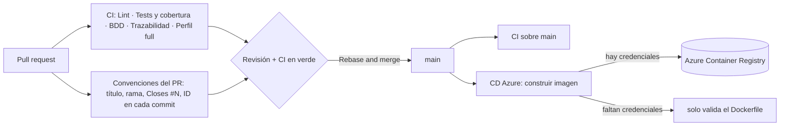

# Integración y entrega continua (CI/CD)

Todo lo que se verifica o se publica sin intervención humana vive en `.github/workflows/`. Este
documento explica qué hace cada workflow, cómo se protege la rama `main` y cómo se configura la
publicación de la imagen en Azure.

## Qué se ejecuta y cuándo

| Workflow | Cuándo | Qué comprueba |
|---|---|---|
| `ci.yml` · **Lint** | PR y `main` | Plantillas generadas, `go vet`, formato, `golangci-lint` y `actionlint` sobre los propios workflows |
| `ci.yml` · **Tests y cobertura** | PR y `main` | Todos los tests con una base Postgres real y los umbrales de cobertura: **85 % en el dominio** y **70 % total** (`scripts/coverage.sh`). Publica el reporte HTML como artefacto |
| `ci.yml` · **BDD** | PR y `main` | Los escenarios Gherkin con godog, también contra Postgres |
| `ci.yml` · **Trazabilidad** | PR y `main` | Avisa si una spec de historia no tiene su `.feature` |
| `ci.yml` · **Perfil full** | PR y `main` | Levanta el `docker compose` completo sobre un volumen vacío y revisa la base (el camino de quien evalúa) |
| `pr-title.yml` · **Convenciones del PR** | PR | Título en Conventional Commits con ID, rama con el formato `tipo/ID-slug`, `Closes #N` en el cuerpo y **el ID en cada commit** del PR (T-014) |
| `cd-azure.yml` · **CD (Azure)** | push a `main` y a mano | Construye la imagen Docker y, si hay credenciales, la publica en el Azure Container Registry |

## Protección de `main`

Nadie sube a `main` directamente. Las reglas de la rama, que se pueden ver en *Settings → Branches*:

- Hay que pasar los chequeos **Lint**, **Tests y cobertura**, **BDD** y **Titulo y rama**, y la rama tiene que estar al día con `main`.
- Hace falta **1 aprobación** de alguien que no sea el autor, y de un dueño del código cuando el cambio toca su área (`.github/CODEOWNERS`: el dominio y la configuración, de Tomás y Vergara; las specs y los escenarios, de los tres).
- Un cambio nuevo en el PR **descarta** las aprobaciones anteriores.
- Se mergea siempre con *Rebase and merge*, para que la historia conserve los commits RED y GREEN de cada ciclo TDD.

## CD: publicar la imagen en Azure

El workflow `cd-azure.yml` hace esto en cada merge a `main`:

1. **Configuración:** revisa si existen el secreto y las variables de abajo. Si falta alguno, avisa con
   una anotación en la ejecución y sigue sin publicar (el repositorio no se pone en rojo antes de tener las credenciales).
2. **Login** en Azure con `azure/login` y en el registro con `az acr login`.
3. **Construye** la imagen con el `Dockerfile` (en Ubuntu, con la caché de GitHub) y la **publica** como
   `<ACR_NAME>.azurecr.io/<IMAGE_NAME>:<sha del commit>` y `:latest`.
4. Deja en el **resumen de la ejecución** el nombre de la imagen y su digest.

### Cómo configurarlo

En el repositorio: *Settings → Secrets and variables → Actions*.

| Tipo | Nombre | Valor |
|---|---|---|
| Secreto | `AZURE_CREDENTIALS` | El JSON del *service principal* que entrega la cátedra, pegado tal cual |
| Variable | `ACR_NAME` | El nombre del registro, **sin** `.azurecr.io` |
| Variable | `IMAGE_NAME` | El nombre de la imagen dentro del registro |

El service principal necesita al menos el rol **AcrPush** sobre el registro.

Para probarlo: *Actions → CD (Azure) → Run workflow*. Si todo está bien, el resumen muestra la imagen
publicada y se puede comprobar con `az acr repository show-tags --name <ACR_NAME> --repository <IMAGE_NAME>`.

### Seguridad

- **El JSON nunca se escribe en el repositorio ni en el log.** Solo lo recibe `azure/login`; el workflow
  comprueba que el secreto existe sin mostrar su valor.
- **Las acciones de terceros están fijadas por el hash exacto de su versión** (`azure/login`, `docker/*`).
  Si alguien moviera la etiqueta de una versión, el workflow seguiría usando el código que se revisó.
  Son acciones oficiales de Microsoft y Docker, las mismas que documentan sus productos.
- **Permisos mínimos:** el token del workflow solo puede leer el repositorio.
- **Los PR no publican nada:** el workflow no corre en `pull_request`, y los PR de repositorios ajenos no
  reciben los secretos.
- `actionlint` revisa todos los workflows en cada PR, así que un error de sintaxis o un uso inseguro de
  una expresión no llega a `main`.

### Pendiente

El despliegue (que la imagen publicada se ejecute en un servicio de Azure, por ejemplo App Service o
Container Apps) depende de lo que defina la cátedra y de la base de datos que se use en ese entorno.
Cuando esté decidido se agrega como un job más a este workflow, con la misma configuración.
