# Manual de usuario

Este manual recorre **Software Metrics & Estimation** pantalla por pantalla, en el orden en que la usa
un equipo: primero el proyecto y sus integrantes, después el backlog, los sprints, la estimación con
Planning Poker, las horas trabajadas y los defectos. Para cada pantalla dice para qué sirve, qué se
carga y qué errores puede mostrar.

Las capturas son de la aplicación real, en una máquina local con los datos de ejemplo y un proyecto de
demostración, **Tienda online**, que se cargó desde las mismas pantallas (28/10/2026). Las pantallas que
todavía no están en `main` se marcan **(en desarrollo)**.

## Antes de empezar

**Cómo abrirla.** Con Docker instalado, desde la carpeta del proyecto:

```bash
docker compose --profile full up
```

y abrir <http://localhost:8080>. Ya viene cargado un proyecto de ejemplo, *Software Metrics & Estimation*,
con tres integrantes. Para desarrollar, ver la [documentación técnica](documentacion-tecnica.md#5-cómo-correrlo).

**Cómo se navega.** Arriba hay dos barras:

- La **principal**, con *Inicio* y *Proyectos*.
- La **del proyecto**, que aparece cuando se entra a uno: *Resumen*, *Backlog*, *Sprints*, *Esfuerzo*,
  *Métricas* y *Defectos*. La sección en la que se está queda subrayada.

**Cómo se ven los errores.** Cuando algo no se puede guardar, la pantalla no cambia y aparece arriba un
recuadro rojo con **todos** los problemas juntos, para corregirlos de una vez (no uno por uno). Hay tres
tipos:

| Tipo | Cuándo pasa | Ejemplo |
|---|---|---|
| Dato inválido | Lo que se escribió no cumple una regla | "el Sprint Goal es obligatorio" |
| Conflicto | El dato está bien, pero choca con lo que ya está guardado | "ya hay un integrante con ese email en el proyecto" |
| No existe | Se pidió algo que no está (un enlace viejo, un proyecto borrado) | página "Página no encontrada" |

Si falla algo del sistema (por ejemplo, la base de datos no responde), se muestra un mensaje general sin
detalles técnicos.

> Las capturas de errores se armaron con la respuesta real del servidor puesta en el lugar donde la
> muestra la pantalla, porque una captura automática no puede enviar formularios.

---

## 1. Inicio y proyectos

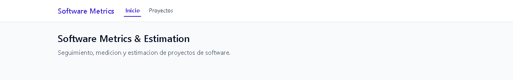

**Proyectos** lista todos los proyectos con sus fechas. Se entra a uno tocando su nombre, y se crea uno
nuevo con **Nuevo proyecto**.

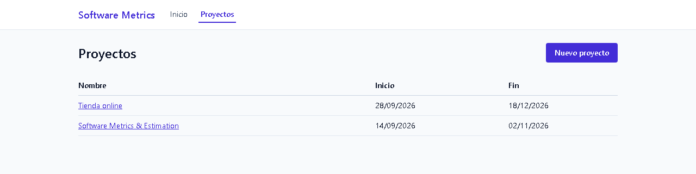

### Crear o editar un proyecto

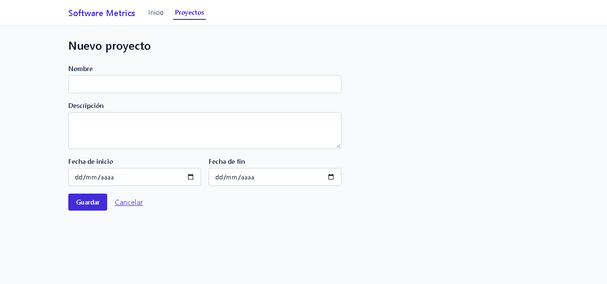

| Campo | Qué va | Reglas |
|---|---|---|
| Nombre | Cómo se llama el proyecto | Obligatorio, hasta 100 caracteres |
| Descripción | Para qué es | Opcional |
| Fecha de inicio y de fin | Cuándo empieza y termina | Las dos obligatorias; el fin no puede ser anterior al inicio |

Para cambiar los datos, en el resumen del proyecto se usa **Editar proyecto**; el formulario y las
reglas son los mismos.

**Errores posibles:** "el nombre es obligatorio", "el nombre supera el largo maximo (100 caracteres)",
"falta la fecha de inicio", "falta la fecha de fin", "fecha de fin anterior a la de inicio".

## 2. Resumen del proyecto e integrantes

La primera pestaña del proyecto muestra el **estado general**, sus datos, accesos al backlog y a los
sprints, y la lista de integrantes con un formulario para sumar más.

La tarjeta **Estado general** dice si el proyecto está *no iniciado*, *en curso* o *finalizado* según
sus fechas y la de hoy, y resume el avance: cuántas historias hay pendientes, en progreso y completadas,
los Story Points completados sobre el total, el porcentaje de historias completadas y el sprint abierto
(con un enlace a él), o "Sin sprint abierto". Si el cálculo falla, la tarjeta muestra el error y el resto
de la página se ve igual.

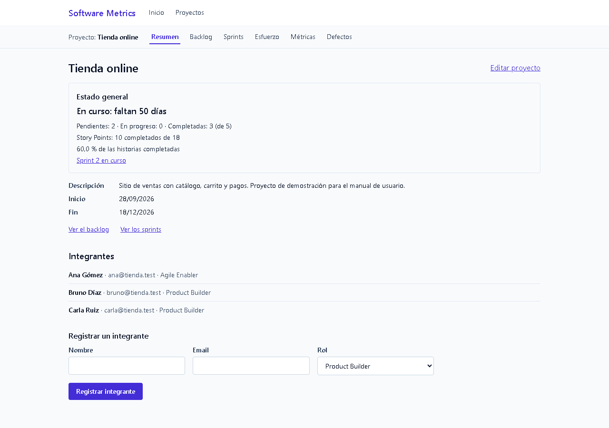

| Campo | Qué va | Reglas |
|---|---|---|
| Nombre | Nombre del integrante | Obligatorio, hasta 100 caracteres |
| Email | Su email | Obligatorio, con formato válido y **sin repetirse dentro del proyecto** |
| Rol | Product Builder, Agile Enabler o Product Architect | Uno de los tres |

**Errores posibles:** "el nombre es obligatorio", "el email es obligatorio", "el email no tiene un formato
valido" y, si el email ya está en el proyecto:

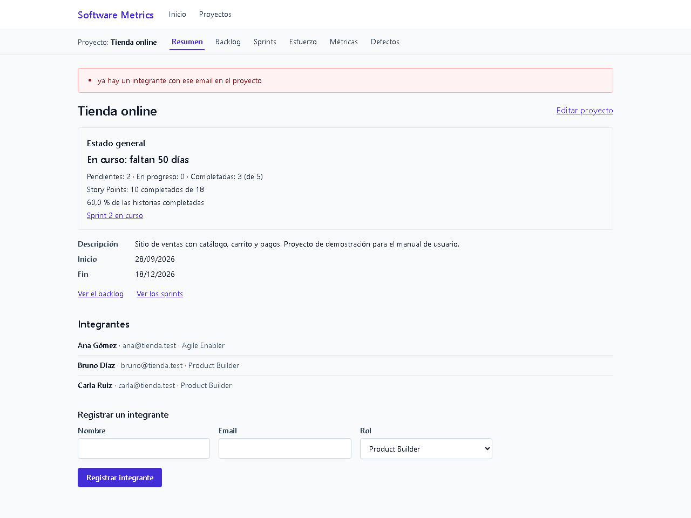

## 3. Backlog

El Product Backlog lista las historias del proyecto en orden de número, con su prioridad, estado, Story
Points y cantidad de criterios de aceptación. Desde cada fila se estima, se edita o se abre Planning
Poker. Abajo está el formulario para cargar una historia nueva.

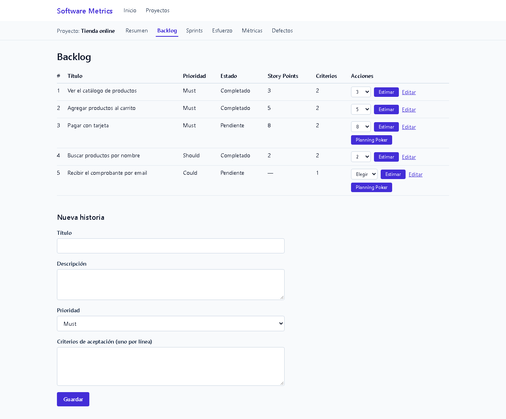

### Cargar una historia

| Campo | Qué va | Reglas |
|---|---|---|
| Título | Qué hace la historia | Obligatorio, hasta 120 caracteres |
| Descripción | Detalle ("Como … quiero … para …") | Opcional |
| Prioridad | Must, Should, Could o Won't (MoSCoW) | Una de las cuatro |
| Criterios de aceptación | Uno por línea | Ninguna línea vacía. Sin criterios se puede guardar, pero no se puede asignar a un sprint |

La historia recibe el número siguiente del proyecto y empieza **Pendiente** y sin estimar.

### Estimar

En la columna *Acciones* se elige un valor de la escala Fibonacci (1, 2, 3, 5, 8 o 13) y se toca
**Estimar**. Para estimar en equipo está [Planning Poker](#5-planning-poker).

### Editar y repriorizar

**Editar** abre el formulario con los datos actuales: se puede cambiar el título, la descripción, la
prioridad y los criterios. El número, el estado y la estimación no cambian.

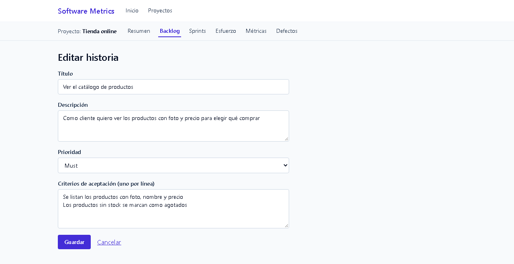

**Errores posibles:** "el titulo es obligatorio", "el titulo no puede tener mas de 120 caracteres", "la
prioridad tiene que ser must, should, could o wont", "el criterio de aceptacion esta vacio", "la
estimacion tiene que ser 1, 2, 3, 5, 8 o 13" y "el item esta completado" (una historia completada no se
edita ni se estima).

**Listar y filtrar el backlog (fuera de alcance).** Filtrar por estado y prioridad (US-007) quedó afuera
del alcance del proyecto.

## 4. Sprints

### Lista de sprints y crear uno nuevo

Muestra cada sprint con su Sprint Goal, fechas, estado, cantidad de historias y Story Points planificados
y completados. Abajo se crea el siguiente.

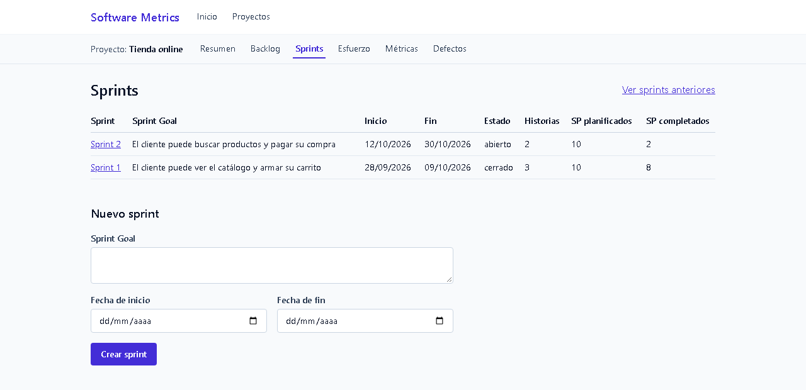

| Campo | Qué va | Reglas |
|---|---|---|
| Sprint Goal | El objetivo del sprint | Obligatorio, hasta 200 caracteres |
| Fecha de inicio y de fin | Duración del sprint | Dentro de las fechas del proyecto, hasta 28 días, y empezando después de que termine el último sprint |

Solo puede haber **un sprint abierto** por proyecto: para crear el siguiente, primero hay que cerrar el
actual.

**Errores posibles:** "el Sprint Goal es obligatorio", "el Sprint Goal no puede tener mas de 200
caracteres", "el sprint no puede durar mas de 28 dias", "las fechas del sprint tienen que estar dentro de
las del proyecto", "el sprint tiene que empezar despues de que termine el ultimo sprint del proyecto" y
"no se puede crear un sprint mientras el ultimo sigue abierto: primero hay que cerrarlo".

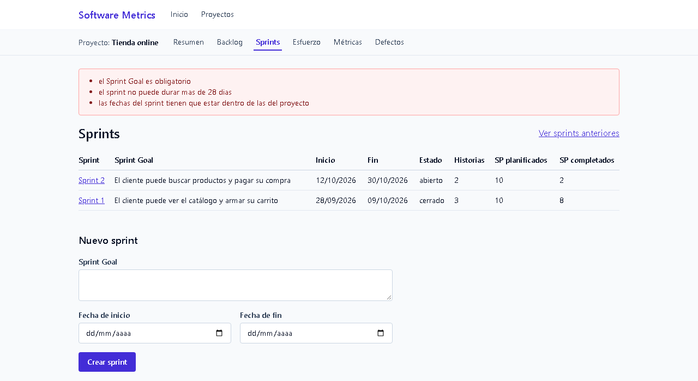

### Detalle de un sprint: asignar, marcar y cerrar

Se entra tocando el nombre del sprint. Muestra su Sprint Goal, fechas, estado y los Story Points
planificados y completados, y la lista de sus historias.

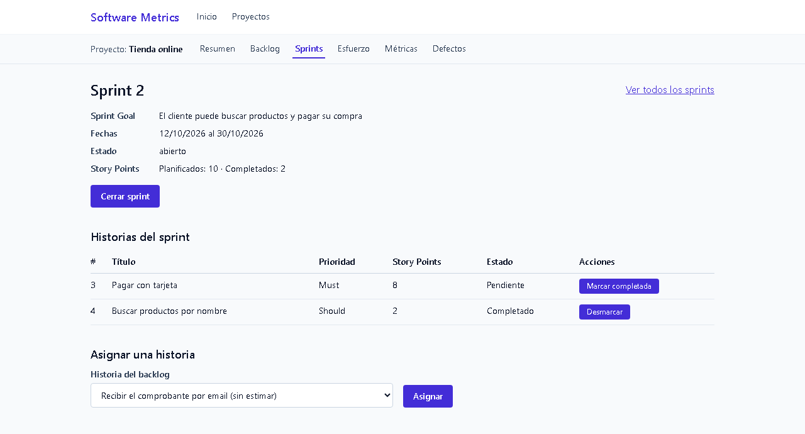

- **Asignar una historia:** se elige del backlog y se toca **Asignar**. La historia tiene que estar
  estimada, tener criterios de aceptación, no estar completada y no estar asignada a otro sprint abierto.
- **Marcar completada / Desmarcar:** cambia el estado de la historia dentro del sprint. Cuenta para los
  Story Points completados.
- **Cerrar sprint:** termina el sprint. Las historias no completadas **vuelven al backlog** y se pueden
  asignar al siguiente; el sprint conserva el registro de lo que tenía y de cómo terminó cada una.

**Errores posibles:** "la historia no esta estimada: estimala antes de asignarla", "la historia no tiene
criterios de aceptacion", "la historia ya esta asignada a un sprint", "el item esta completado", "la
historia no esta asignada a este sprint" y "el sprint esta cerrado" (un sprint cerrado no se modifica).

### Sprints anteriores

**Ver sprints anteriores** muestra los sprints cerrados con lo planificado, lo completado, cuántas
historias se completaron y cuántas no, y la **velocidad del equipo**: el promedio de Story Points
completados por sprint cerrado.

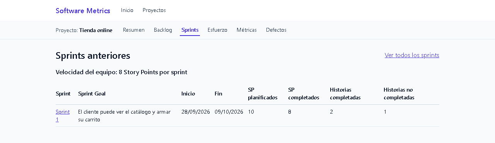

## 5. Planning Poker

Sirve para estimar una historia en equipo sin que nadie se deje influir por los votos de los demás.

1. **Iniciar.** En el backlog, la fila de una historia pendiente tiene el botón **Planning Poker** (ver la
   captura del [backlog](#3-backlog)). Inicia una sesión con todos los integrantes del proyecto como
   participantes. Si la historia ya tiene una sesión abierta, el botón lleva a esa sesión.
2. **Votar.** Cada participante se elige en *Votás como* y toca una carta (1, 2, 3, 5, 8 o 13). La pantalla
   muestra **quién votó y quién falta, nunca un valor**. Votar de nuevo reemplaza el voto anterior.

   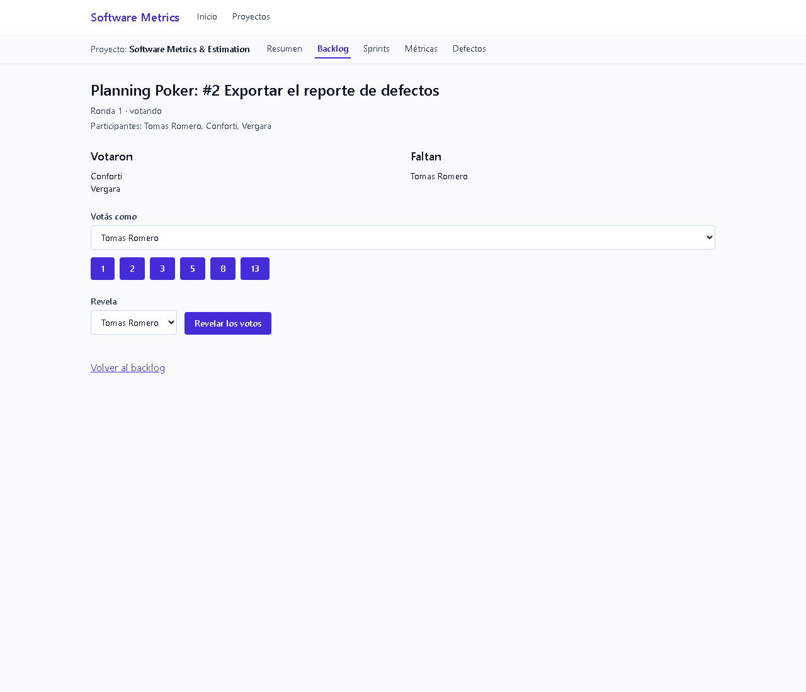

3. **Revelar.** Con al menos un voto, **Revelar los votos** muestra cada voto, quién no votó y, si los
   valores no coinciden, la **divergencia** (de cuánto a cuánto).

   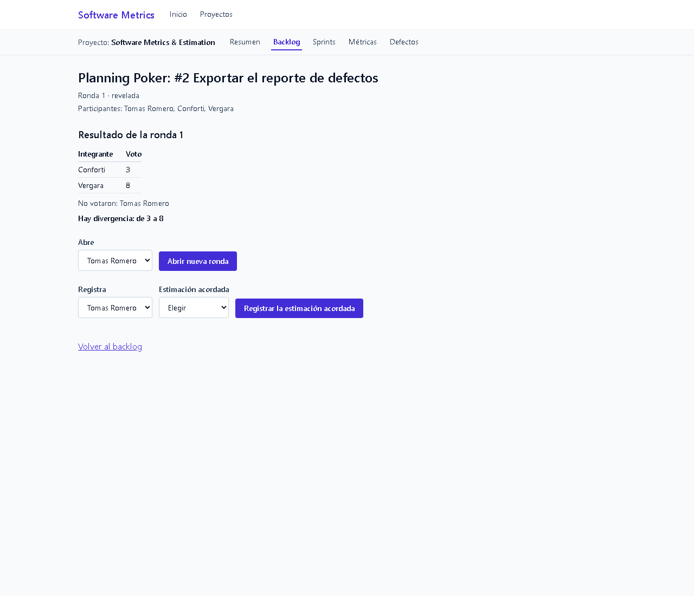

4. **Nueva ronda o acuerdo.**
   - Con divergencia, **Abrir nueva ronda** vuelve a votar desde cero; las rondas anteriores quedan
     visibles con su resultado.
   - **Registrar la estimación acordada** cierra la sesión y deja ese valor como los Story Points de la
     historia.

   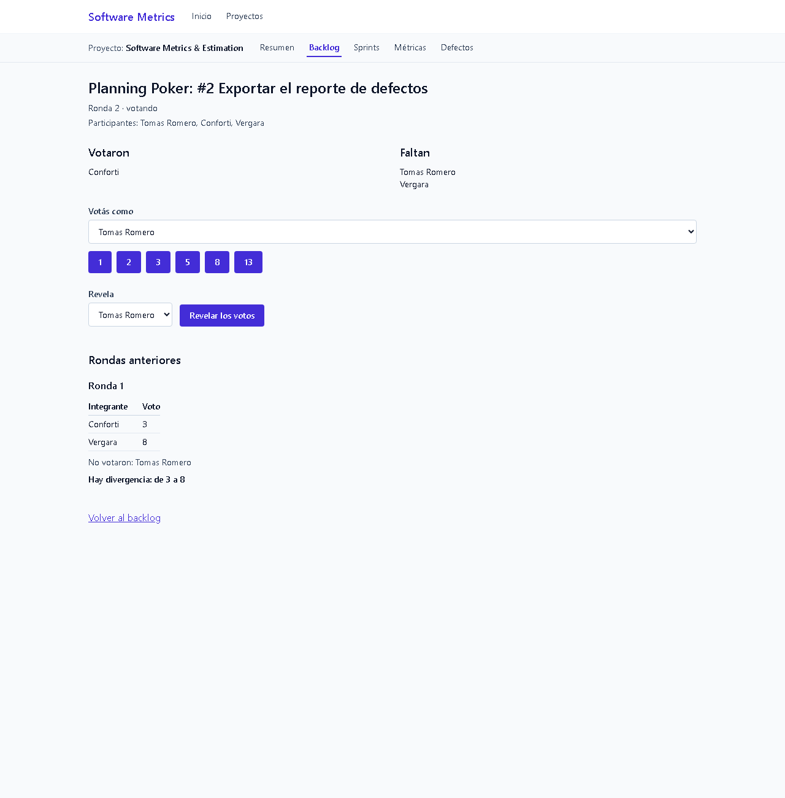

**Errores posibles:** "se necesitan al menos 2 integrantes en el proyecto para una sesion de planning
poker", "la historia ya tiene una sesion de planning poker abierta", "el integrante no participa de esta
sesion de planning poker", "la votacion de esta ronda esta cerrada", "no hay votos para revelar en esta
ronda", "no hay divergencia: registren la estimacion acordada", "la nueva ronda se abre con los votos
revelados y la sesion sin finalizar" y "la estimacion acordada se registra con los votos revelados y la
sesion sin finalizar". Una historia completada no se puede estimar.

La pantalla no se actualiza sola: para ver los votos de los demás hay que recargarla.

## 6. Esfuerzo

### Registrar horas y consultarlas

Cada integrante carga las horas que trabajó en una historia. Debajo del formulario se ven todos los
registros, con filtros por historia, integrante y sprint, y los totales por historia, por integrante y
por sprint.

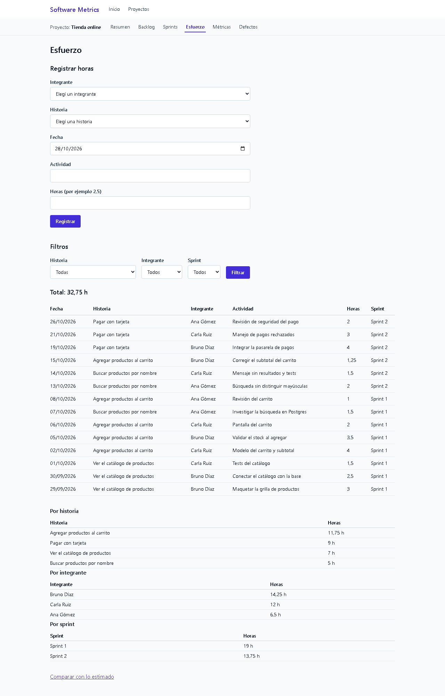

| Campo | Qué va | Reglas |
|---|---|---|
| Integrante | Quién trabajó | Del proyecto |
| Historia | En qué historia | Del proyecto |
| Fecha | Qué día | Obligatoria y no posterior a hoy. Viene con la fecha de hoy |
| Actividad | Qué se hizo | Obligatoria, hasta 120 caracteres |
| Horas | Cuánto tiempo | Más de 0 y hasta 24, en múltiplos de 0,25 (por ejemplo 2,5 o 1,25) |

Las horas cuentan en el sprint que incluye la **fecha** en que se trabajaron, aunque la historia después
pase a otro sprint.

**Errores posibles:** "la fecha es obligatoria", "la fecha no puede ser posterior a hoy", "la actividad
es obligatoria", "la actividad no puede tener mas de 120 caracteres", "las horas tienen que ser mayores a
0 y no pasar de 24", "las horas se registran en multiplos de 0,25", "el integrante no existe" y "el item no
existe".

### Estimado contra real

**Comparar con lo estimado** muestra, por historia, los Story Points, las horas estimadas (a 1,5 horas por
Story Point), las horas reales y la desviación en horas y en porcentaje. Al final suma las historias
comparables; las horas de historias sin estimar se informan aparte como "horas sin comparar".

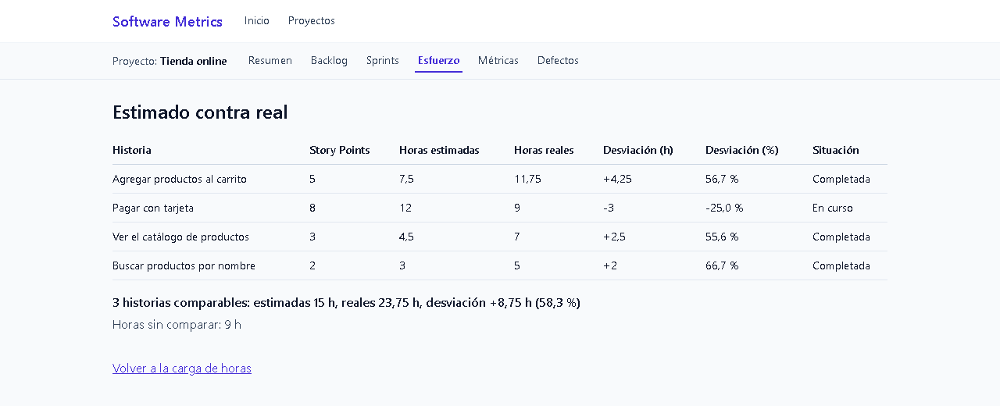

## 7. Defectos

Lista los defectos del proyecto, el más reciente primero, con su severidad, estado, historia relacionada
y sprints de detección y de resolución. Desde cada fila se cambia el estado, y abajo se registra uno
nuevo.

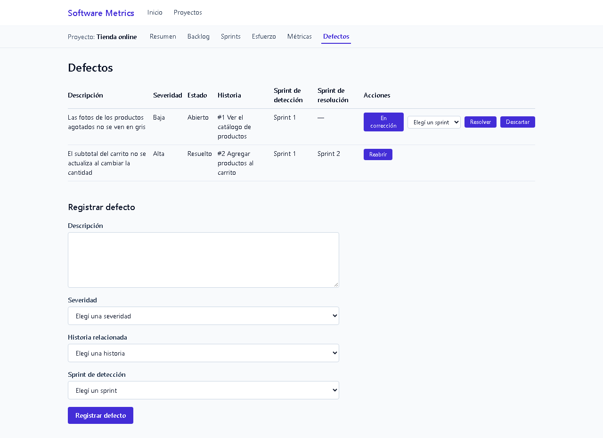

### Registrar un defecto

| Campo | Qué va | Reglas |
|---|---|---|
| Descripción | Qué falla | Obligatoria, hasta 2000 caracteres |
| Severidad | Crítica, Alta, Media o Baja | Una de las cuatro |
| Historia relacionada | La historia donde aparece | Del proyecto |
| Sprint de detección | En qué sprint se encontró | Del proyecto |

Un defecto nuevo empieza **Abierto**.

### Cambiar el estado

| Desde | Puede pasar a |
|---|---|
| Abierto | En corrección, Resuelto o Descartado |
| En corrección | Abierto, Resuelto o Descartado |
| Resuelto | Abierto (reabrir) |
| Descartado | Abierto (reabrir) |

Para **Resolver** hay que elegir el sprint de resolución, que no puede ser anterior al de detección. Al
reabrirlo, el defecto pierde el sprint de resolución.

**Errores posibles:** "la descripcion es obligatoria", "la descripcion no puede tener mas de 2000
caracteres", "la severidad tiene que ser critica, alta, media o baja", "el defecto no puede pasar a ese
estado desde el actual", "el sprint de resolucion no puede ser anterior al de deteccion", "solo un defecto
resuelto tiene sprint de resolucion", "el defecto cambio mientras se lo editaba" (otra persona lo cambió
al mismo tiempo: hay que recargar) y, si se toca **Resolver** sin elegir sprint:

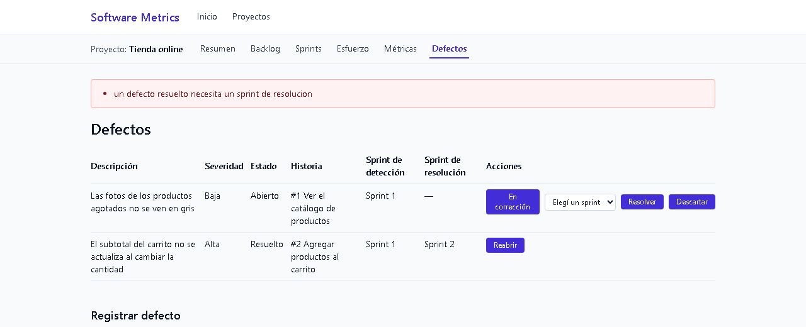

**Filtrar por sprint y severidad (en desarrollo).** El filtro (US-024) tiene su spec, pero todavía no
está implementado.

## 8. Dashboard y métricas (en desarrollo)

La pestaña **Métricas** va a mostrar el dashboard del proyecto (US-030): Story Points planificados y
completados, velocidad, horas estimadas contra reales, porcentaje de historias completadas y defectos por
sprint, con dos gráficos. Los cálculos ya están hechos y probados, y algunos se ven en otras pantallas
(la velocidad en *Sprints anteriores*, la desviación en *Estimado contra real*), pero la pantalla todavía
no está en `main`: hoy el enlace muestra "Página no encontrada".

## 9. Reporte imprimible (en desarrollo)

El reporte de un proyecto o de un sprint en pantalla (US-033) y su vista imprimible para guardarlo como
PDF desde el navegador (US-034) tienen su spec, pero todavía no están en `main`.

---

## Recorrido sugerido para probarla

1. **Proyectos → Nuevo proyecto:** crear el proyecto.
2. **Resumen:** registrar al menos dos integrantes (Planning Poker necesita dos).
3. **Backlog:** cargar tres o cuatro historias con criterios de aceptación.
4. **Backlog → Planning Poker:** estimar una historia votando con cada integrante, revelar y registrar la
   estimación acordada. Estimar las demás con el selector de la fila.
5. **Sprints:** crear el Sprint 1, asignarle historias y marcar alguna como completada.
6. **Esfuerzo:** registrar horas de cada integrante y mirar **Comparar con lo estimado**.
7. **Defectos:** registrar un defecto y pasarlo a resuelto en un sprint.
8. **Sprints → Cerrar sprint:** las historias no completadas vuelven al backlog. Crear el Sprint 2 y mirar
   **Ver sprints anteriores** para ver la velocidad.
